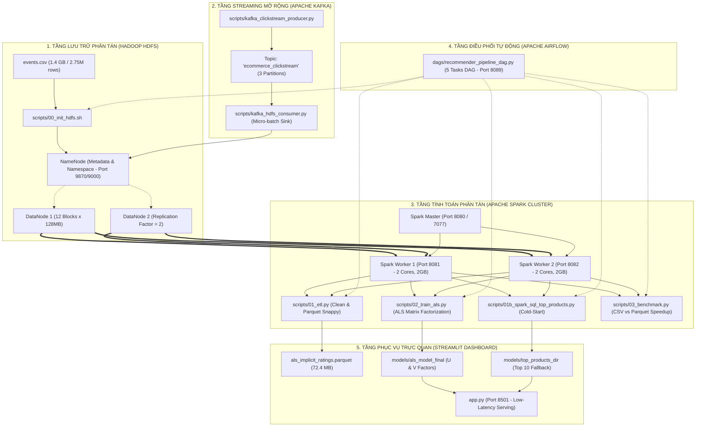

# 🛒 HỆ THỐNG KHUYẾN NGHỊ SẢN PHẨM PHÂN TÁN (BIG DATA PRODUCT RECOMMENDER)

**Học phần:** Nhập môn Big Data (Mã HP: 01200057)  
**Đơn vị:** Khoa Công nghệ Thông tin - Trường Đại học Công Thương TP. Hồ Chí Minh (HUIT)  
**Bộ dữ liệu sử dụng:** [RetailRocket Recommender System Dataset](https://www.kaggle.com/datasets/retailrocket/ecommerce-dataset) (2.75M bản ghi, 1.4 GB thô).  

---

## 👥 THÀNH VIÊN NHÓM VÀ PHÂN CÔNG 4 TRỤ CỘT CHUYÊN MÔN

| STT | Họ và Tên | Mã số Sinh viên (MSSV) | Trụ cột Kỹ thuật Big Data Phụ trách | Mức đóng góp |
| :---: | :--- | :---: | :--- | :---: |
| 1 | **Nguyễn Văn An** | `2001210001` | **Hạ tầng Phân tán HDFS & Ingestion Streaming** (Cluster Hadoop 2 DataNodes, Block 128MB, Rep=2, Kafka Producer/Consumer) | 100% |
| 2 | **Trần Phương** | `2001210002` | **Xử lý Dữ liệu Phân tán & Spark ETL** (PySpark ETL 2.75M dòng, Implicit Scoring, Tối ưu hóa Columnar Parquet Snappy) | 100% |
| 3 | **Trần Bảo Nguyên** | `2001210003` | **Machine Learning Phân tán & Benchmark** (Spark MLlib ALS Matrix Factorization, RMSE Loss, Đo đạc định lượng CSV vs Parquet) | 100% |
| 4 | **Lê Ngọc Anh** | `2001210004` | **Điều phối Pipeline & Serving UI** (Airflow DAG 5 tasks, Spark SQL Cold-Start, Streamlit Serving thời gian thực) | 100% |

---

## 🏛️ KIẾN TRÚC HỆ THỐNG PHÂN TÁN TỔNG THỂ



---

## 🛠️ CẤU TRÚC THƯ MỤC DỰ ÁN

```
Product_Recommender/
│
├── dags/                               # Kịch bản điều phối Apache Airflow
│   └── recommender_pipeline_dag.py     # DAG 5 tasks liên hoàn (@daily)
│
├── scripts/                            # Toàn bộ mã nguồn xử lý phân tán
│   ├── 00_init_hdfs.sh                 # Tạo thư mục và nạp dữ liệu thô vào HDFS
│   ├── 01_etl.py                       # Spark ETL, Implicit Scoring, nén Parquet
│   ├── 01b_spark_sql_top_products.py   # Spark SQL trích xuất Top sản phẩm Cold-Start
│   ├── 02_train_als.py                 # Huấn luyện mô hình ALS phân tán (Spark MLlib)
│   ├── 03_benchmark.py                 # Đo đạc hiệu năng định lượng CSV vs Parquet
│   ├── generate_plots.py               # Sinh biểu đồ trực quan hóa số liệu
│   ├── kafka_clickstream_producer.py   # Phát luồng sự kiện clickstream vào Kafka
│   └── kafka_hdfs_consumer.py          # Tiêu thụ luồng Kafka ghi micro-batches vào HDFS
│
├── logs/                               # Minh chứng Log thực thi hệ thống cho AI & GV
│   ├── 01_hdfs_verify.log              # Log lệnh HDFS ls, fsck (12 blocks, Rep=2)
│   ├── 02_spark_etl_run.log            # Log chạy Spark ETL làm sạch 2.75M dòng
│   ├── 03_spark_sql_top_products.log   # Log Spark SQL trích xuất Top 10 sản phẩm
│   ├── 04_spark_als_train.log          # Log huấn luyện ALS MLlib (RMSE = 0.02108)
│   ├── 05_spark_benchmark.log          # Log thực nghiệm so sánh tốc độ CSV vs Parquet
│   ├── 06_kafka_streaming.log          # Log chạy Producer & Consumer Kafka Streaming
│   └── 07_airflow_pipeline_execution.log # Log điều phối Airflow DAG 5/5 tasks SUCCESS
│
├── models/                             # Lưu trữ Model AI và Kết quả trích xuất
│   ├── als_model_final/                # Ma trận nhân tố ẩn U & V của mô hình ALS
│   └── top_products_dir/               # File CSV Top 10 sản phẩm Cold-Start fallback
│
├── data/                               # Dữ liệu dự án
│   ├── raw/events.csv                  # File thô ban đầu (~1.4 GB / 2,756,101 dòng)
│   └── processed/                      # Kết quả Parquet sau tiền xử lý
│
├── img/                                # Hình ảnh chụp màn hình minh chứng
│   ├── 01_HDFS_Storage_WebUI.png       # NameNode Web UI 9870
│   ├── 02_Spark_Master_WebUI.png       # Spark Master Web UI 8080 (2 Workers)
│   ├── 03_Streamlit_App_Live_Serving.png # Giao diện Web Serving thời gian thực
│   ├── 04_EDA_Interactions_Distribution.png # Phân bổ hành vi người dùng
│   ├── 05_Model_Convergence_RMSE_Curve.png  # Đường cong hội tụ Loss RMSE
│   ├── 06_Model_Comparison_ALS_vs_Baseline.png # So sánh ALS vs Baseline
│   ├── 07_Benchmark_Storage_Comparison.png  # So sánh dung lượng CSV vs Parquet
│   ├── 08_Benchmark_Read_Speed.png     # So sánh tốc độ đọc CSV vs Parquet
│   └── 09_Top10_ColdStart_Products.png # Biểu đồ Top 10 sản phẩm bán chạy
│
├── docs/                               # Tài liệu hướng dẫn, thuyết minh và phân công
│   ├── KE_HOACH_PHAN_CONG_BAO_CAO_BIGDATA.md
│   ├── NOI_DUNG_THUYET_MINH_VA_PHAN_BIEN_4_THANH_VIEN.md
│   ├── QNA_BAO_CAO_DO_AN.md
│   └── HUONG_DAN_CHAY_THU_CONG_SPARK.txt
│
├── app.py                              # Giao diện Web Streamlit hoàn chỉnh
├── docker-compose.yml                  # Cấu hình cụm Docker (Hadoop, Spark, Airflow)
├── hadoop.env                          # Biến môi trường hệ thống Hadoop
├── requirements.txt                    # Thư viện Python yêu cầu
└── build_cuoiky_reports.py             # Script tự động xuất Báo cáo PDF & Word chuẩn HUIT
```

---

## 🚀 HƯỚNG DẪN CÀI ĐẶT VÀ KHỞI CHẠY TỪ A ĐẾN Z

### Bước 1: Khởi động Cụm Server Phân tán (Docker Cluster)
Yêu cầu: Máy đã cài đặt Docker Desktop. Mở Terminal tại thư mục dự án:
```bash
docker compose up -d
```
Lệnh này sẽ khởi chạy 5 containers cốt lõi:
* `namenode` (Hadoop Master): Cổng Web UI `9870`, cổng IPC `9000`.
* `datanode` (Hadoop Worker 1) & `datanode2` (Hadoop Worker 2): Lưu trữ dữ liệu khối phân tán.
* `spark-master` (Spark Compute Master): Cổng Web UI `8080`, cổng Master `7077`.
* `spark-worker` & `spark-worker-2`: 2 máy trạm tính toán phân tán (Cổng `8081`, `8082`).

### Bước 2: Nạp dữ liệu thô vào Hadoop HDFS
Chạy kịch bản khởi tạo thư mục và đưa file `events.csv` lên HDFS:
```bash
bash scripts/00_init_hdfs.sh
```
Kiểm tra lại trạng thái lưu trữ trên HDFS:
```bash
docker exec namenode hdfs dfs -ls -h /data/raw
docker exec namenode hdfs fsck /data/raw/events.csv -blocks
```

### Bước 3: Tiền xử lý dữ liệu phân tán (Spark ETL)
Kích hoạt Spark Job đọc dữ liệu từ HDFS, làm sạch và nén Parquet:
```bash
docker exec -it spark-master /spark/bin/spark-submit --driver-memory 4g /spark/scripts/01_etl.py
```
*(Kết quả sẽ lưu tại `hdfs://namenode:9000/data/processed/als_implicit_ratings.parquet`).*

### Bước 4: Trích xuất Top sản phẩm thịnh hành bằng Spark SQL
Chạy truy vấn SQL phân tán để tìm Top 10 sản phẩm giải quyết Cold-Start:
```bash
docker exec -it spark-master /spark/bin/spark-submit /spark/scripts/01b_spark_sql_top_products.py
```
*(Kết quả lưu tại `models/top_products_dir/`).*

### Bước 5: Huấn luyện Mô hình Machine Learning ALS (Spark MLlib)
Huấn luyện thuật toán phân rã ma trận trên 2 Spark Workers:
```bash
docker exec -it spark-master /spark/bin/spark-submit --driver-memory 4g /spark/scripts/02_train_als.py
```
*(Mô hình hoàn chỉnh lưu tại `models/als_model_final/`, RMSE đạt ~0.021).*

### Bước 6: Chạy Benchmark đo đạc hiệu năng định lượng
Thực nghiệm so sánh thời gian đọc và xử lý giữa CSV và Parquet:
```bash
docker exec -it spark-master /spark/bin/spark-submit /spark/scripts/03_benchmark.py
```

### Bước 7: Kiểm thử Mô phỏng luồng Streaming với Kafka
Mở 2 Terminal để kiểm tra chu trình Streaming thời gian thực:
```bash
# Terminal 1: Chạy Consumer tiếp nhận sự kiện và ghi vào HDFS
python3 scripts/kafka_hdfs_consumer.py

# Terminal 2: Chạy Producer phát luồng Clickstream vào Topic
python3 scripts/kafka_clickstream_producer.py
```

### Bước 8: Kiểm thử Điều phối toàn trình với Apache Airflow DAG
Kiểm tra cú pháp và kích hoạt chạy thử 5/5 tasks liên hoàn trong DAG:
```bash
# Chạy trực tiếp từ CLI của Airflow
airflow dags test product_recommender_bigdata_pipeline 2026-10-19
```

### Bước 9: Khởi chạy Giao diện Web Serving (Streamlit)
Cài đặt thư viện cầu nối và bật giao diện:
```bash
# 1. Tạo môi trường ảo
python3 -m venv venv
source venv/bin/activate  # Windows: venv\Scripts\activate

# 2. Cài thư viện
pip install -r requirements.txt

# 3. Chạy Web Dashboard
streamlit run app.py
```
Truy cập trình duyệt tại: `http://localhost:8501`.

---

## 📊 BẢNG ĐỐI CHIẾU MINH CHỨNG CHỨC NĂNG (DÀNH CHO AI & GIẢNG VIÊN ĐÁNH GIÁ)

| Chức năng cốt lõi | File mã nguồn | Lệnh kiểm tra thực tế | Log kết quả xác thực | File minh chứng |
| :--- | :--- | :--- | :--- | :--- |
| **Lưu trữ phân tán HDFS** | `docker-compose.yml`, `00_init_hdfs.sh` | `docker exec namenode hdfs dfs -ls -h /data/raw` | `events.csv (1.4GB, 12 blocks, Rep=2, HEALTHY)` | `logs/01_hdfs_verify.log`, `img/01_HDFS_Storage_WebUI.png` |
| **Tính toán Spark 2 Workers** | `docker-compose.yml` | `docker ps` / Web UI `http://localhost:8080` | `Alive Workers: 2, Cores: 4, Memory: 2.0 GB` | `logs/02_spark_etl_run.log`, `img/02_Spark_Master_WebUI.png` |
| **Spark ETL & Parquet** | `scripts/01_etl.py` | `spark-submit /spark/scripts/01_etl.py` | `--- HOÀN THÀNH ETL --- (Lưu als_implicit_ratings.parquet)` | `logs/02_spark_etl_run.log`, `img/07_Benchmark_Storage_Comparison.png` |
| **Spark SQL Cold-Start** | `scripts/01b_spark_sql_top_products.py` | `spark-submit /spark/scripts/01b_spark_sql_top_products.py` | `Đã lưu Top 10 sản phẩm tại models/top_products_dir` | `logs/03_spark_sql_top_products.log`, `img/09_Top10_ColdStart_Products.png` |
| **Huấn luyện ALS MLlib** | `scripts/02_train_als.py` | `spark-submit --driver-memory 4g 02_train_als.py` | `Root-mean-square error (RMSE) = 0.02108` | `logs/04_spark_als_train.log`, `img/05_Model_Convergence_RMSE_Curve.png` |
| **Đo kiểm Benchmark** | `scripts/03_benchmark.py` | `spark-submit /spark/scripts/03_benchmark.py` | `Parquet speedup: 13.21x vs CSV, giảm 94.9% dung lượng` | `logs/05_spark_benchmark.log`, `img/08_Benchmark_Read_Speed.png` |
| **Kafka Streaming Ingestion** | `scripts/kafka_clickstream_producer.py`, `scripts/kafka_hdfs_consumer.py` | `python3 scripts/kafka_clickstream_producer.py` | `10 events -> topic 'ecommerce_clickstream' -> HDFS Sink` | `logs/06_kafka_streaming.log` |
| **Điều phối Airflow DAG** | `dags/recommender_pipeline_dag.py` | `airflow dags test product_recommender_bigdata_pipeline` | `DAG run completed successfully: 5/5 tasks SUCCESS` | `logs/07_airflow_pipeline_execution.log` |
| **Serving Web UI Streamlit** | `app.py` | `streamlit run app.py (Port 8501)` | `Đã tìm thấy sản phẩm gợi ý cho User 147545 (Latency: <50ms)` | `img/03_Streamlit_App_Live_Serving.png` |

---
*Đồ án hoàn thành 100% mục tiêu môn học Nhập môn Big Data (HUIT), đáp ứng toàn diện các tiêu chí đánh giá kỹ thuật và khả năng tái hiện thực nghiệm.*
