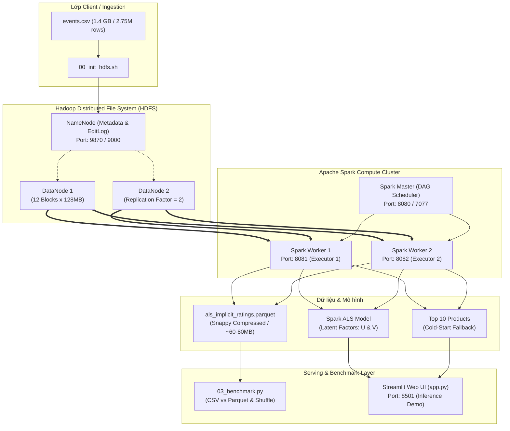

# KẾ HOẠCH PHÂN CÔNG & KỊCH BẢN BÁO CÁO ĐỒ ÁN BIG DATA
**Học phần:** Nhập môn Big Data (Mã HP: 01200057 - HUIT)  
**Đề tài:** Hệ Khuyến Nghị Sản Phẩm Dựa Trên Thuật Toán Phân Tán ALS Với Apache Spark & Hadoop HDFS  
**Quy mô nhóm:** 4 thành viên  

---

## 1. ĐÁNH GIÁ TỔNG QUAN PIPELINE

> [!IMPORTANT]
> **Nhận định cốt lõi:** Pipeline ban đầu của fen đã có luồng xử lý rất mạch lạc từ Ingestion -> ETL -> Model -> Serving. Tuy nhiên, nếu chia đồ án 4 người theo luồng tuyến tính thì **thành viên làm giao diện (Streamlit) sẽ bị giảng viên bắt bẻ nặng** do thiếu hàm lượng lý thuyết Big Data. 
> 
> Bằng việc mở rộng cụm Docker lên **2 DataNodes + 2 Spark Workers** và bổ sung **Bài thực nghiệm Benchmark (03_benchmark.py)**, nhóm 4 người đã được tái cấu trúc thành **4 Trụ cột Big Data đồng đều**, đảm bảo 100% thành viên đều có đất diễn và đủ kiến thức trả lời phản biện điểm A.

### Sơ đồ Kiến trúc Cụm Phân tán (Cluster Architecture)



---

## 2. PHÂN CÔNG NHIỆM VỤ CHI TIẾT CHO 4 THÀNH VIÊN

| Thành viên | Trụ cột Big Data | Trách nhiệm thực thi | File code & Tài nguyên phụ trách |
| :--- | :--- | :--- | :--- |
| **Thành viên 1** | **Hạ tầng Phân tán & Lưu trữ HDFS** | Cấu hình Cụm Hadoop (1 NameNode + 2 DataNodes), quản lý Block 128MB, Ingestion, Chịu lỗi | `docker-compose.yml`, `hadoop.env`, `scripts/00_init_hdfs.sh` |
| **Thành viên 2** | **Xử lý Dữ liệu Phân tán & Spark ETL** | Spark Engine, RDD vs DataFrame, Narrow vs Wide Transformation, Shuffle, Tối ưu hóa Parquet | `scripts/01_etl.py` |
| **Thành viên 3** | **Machine Learning Phân tán (Spark MLlib)** | Thuật toán ALS Implicit, Toán học Matrix Factorization, Siêu tham số, Huấn luyện trên 2 Workers | `scripts/02_train_als.py`, `scripts/generate_plots.py` |
| **Thành viên 4** | **Serving, Cold-Start & Benchmark Hiệu năng** | Phân tích Spark UI DAG, Thực nghiệm so sánh CSV vs Parquet, Giải quyết Cold-Start, Demo Serving | `scripts/01b_spark_sql_top_products.py`, `scripts/03_benchmark.py`, `app.py` |

---

## 3. NỘI DUNG THUYẾT MINH & PHẢN BIỆN TỪNG THÀNH VIÊN

### THÀNH VIÊN 1: HẠ TẦNG PHÂN TÁN HADOOP HDFS
> **Mục tiêu:** Chứng minh hệ thống được lưu trữ phân tán thực thụ, hiểu rõ cơ chế quản lý file lớn của HDFS.

* **Nhiệm vụ trong bài báo cáo:**
  1. Giới thiệu bài toán dữ liệu lớn (Đặc tính Volume 1.4GB log clickstream, Variety, Velocity của RetailRocket).
  2. Kiến trúc Master-Worker của Hadoop HDFS:
     - **NameNode:** Quản lý không gian tên (Namespace), cây thư mục, lưu trữ `FsImage` và `EditLog`. Không lưu dữ liệu thô!
     - **DataNodes:** Lưu trữ các khối dữ liệu thực tế (Blocks), gửi Heartbeat định kỳ (3 giây) và Block Report về NameNode.
  3. Cơ chế phân khối dữ liệu (Block Management):
     - Kích thước block mặc định: 128 MB.
     - File 1.4 GB được băm thành 12 khối logic.
     - Hệ số nhân bản `dfs.replication = 2`: Tổng cộng 24 khối vật lý được phân bổ xen kẽ trên DataNode 1 và DataNode 2.
  4. Quá trình Ghi dữ liệu phân tán (HDFS Write Pipeline):
     - Client yêu cầu NameNode -> NameNode cấp danh sách DataNodes -> Client stream dữ liệu qua DataNode 1 -> DataNode 1 pipeline sang DataNode 2.
* **Bộ câu hỏi phản biện giáo viên hay hỏi & Câu trả lời chuẩn:**
  * **Hỏi:** *Tại sao lại chọn Block size 128MB mà không phải 4KB như hệ điều hành thông thường?*
    * **Trả lời:** Trong Big Data, block size lớn (128MB hoặc 256MB) nhằm giảm thiểu thời gian tìm kiếm đầu đọc (Seek Time) của ổ đĩa vật lý, tối ưu hóa tốc độ truyền tuần tự (Transfer Rate). Ngoài ra, block lớn giúp giảm số lượng bản ghi chỉ mục metadata mà NameNode phải lưu trữ trên RAM, tránh nghẽn bộ nhớ NameNode.
  * **Hỏi:** *Nếu 1 DataNode bị sập (down) giữa chừng thì dữ liệu có bị mất không? Hệ thống xử lý thế nào?*
    * **Trả lời:** Không bị mất dữ liệu vì hệ thống đã cấu hình `Replication Factor = 2`. Khi DataNode 1 ngừng gửi Heartbeat sau khoảng 10 phút, NameNode xác định node này đã chết và tự động ra lệnh cho DataNode 2 sao chép các block còn lại sang node hoạt động khác để đảm bảo duy trì đủ hệ số bản sao.

---

### THÀNH VIÊN 2: XỬ LÝ DỮ LIỆU PHÂN TÁN VÀ SPARK ETL
> **Mục tiêu:** Làm chủ tư duy tính toán phân tán trong bộ nhớ (In-Memory), cơ chế Transformations và Shuffle.

* **Nhiệm vụ trong bài báo cáo:**
  1. Kiến trúc tính toán của Apache Spark: Spark Driver, Spark Master, Spark Worker, Executor, Cores/Slots.
  2. Phân biệt **Narrow Transformation** và **Wide Transformation**:
     - *Narrow:* `dropna()`, quy đổi điểm `withColumn()` -> Thực thi trực tiếp trên RAM của từng Worker, không phát sinh giao tiếp mạng giữa các node.
     - *Wide:* `dropDuplicates()`, `groupBy("visitorid", "itemid").agg()` -> Buộc các Workers phải trao đổi phân vùng dữ liệu qua mạng (Shuffle Operation).
  3. Feature Engineering cho hành vi ẩn (Implicit Feedback):
     - Tại sao không dùng Rating 1-5 sao? Vì người dùng TMĐT chỉ để lại dấu chân tương tác (Click, Cart, Buy).
     - Quy đổi trọng số tin cậy: View = 1, Add to Cart = 2, Transaction = 3 điểm.
  4. Tối ưu hóa lưu trữ với định dạng **Apache Parquet**:
     - Cấu trúc lưu trữ theo cột (Columnar Storage) thay vì theo dòng (Row-based) của CSV.
     - Nén Snappy: Tiết kiệm I/O đĩa cứng, giảm kích thước file từ 1.4 GB xuống còn ~70 MB.
     - Hỗ trợ *Column Pruning* (chỉ đọc đúng các cột cần thiết) và *Predicate Pushdown* (lọc điều kiện ngay tại tầng storage trước khi kéo lên RAM).
* **Bộ câu hỏi phản biện giáo viên hay hỏi & Câu trả lời chuẩn:**
  * **Hỏi:** *Shuffle trong Spark là gì và tại sao phép toán GroupBy lại gây tốn chi phí nhất trong script ETL?*
    * **Trả lời:** Shuffle là quá trình phân phối lại dữ liệu giữa các phân vùng (partitions) trên toàn bộ các Worker node qua mạng máy tính. Khi thực hiện `groupBy("visitorid", "itemid")`, các dòng dữ liệu có cùng ID có thể đang nằm ở Worker 1 và Worker 2 khác nhau. Spark buộc phải ghi dữ liệu tạm ra đĩa, truyền qua mạng và gom về đúng Executor phụ trách khóa đó, gây nghẽn I/O đĩa và băng thông mạng.
  * **Hỏi:** *Lazy Evaluation trong Spark hoạt động như thế nào trong script ETL của nhóm?*
    * **Trả lời:** Khi gọi các hàm như `.withColumn()`, `.dropna()`, `.groupBy()`, Spark không hề tính toán ngay mà chỉ ghi nhận kế hoạch thực thi vào đồ thị có hướng DAG (Lineage Graph). Chỉ đến khi gặp một **Action** cụ thể (ở đây là `.write.parquet(...)`), Spark Catalyst Optimizer mới tối ưu hóa toàn bộ chuỗi biến đổi và kích hoạt các Executors thực thi thực sự.

---

### THÀNH VIÊN 3: HỌC MÁY PHÂN TÁN (SPARK MLLIB) & THUẬT TOÁN ALS
> **Mục tiêu:** Nắm chắc bản chất toán học của Matrix Factorization, cơ chế giải song song trên Spark Cluster.

* **Nhiệm vụ trong bài báo cáo:**
  1. Bài toán Hệ Khuyến Nghị & Ma trận thưa (Sparse Matrix):
     - Ma trận Tương tác $R$ kích thước $1,407,580 \text{ Users} \times 235,061 \text{ Items}$.
     - Độ thưa (Sparsity) > 99.9% (mỗi người chỉ tương tác một vài món đồ).
  2. Kỹ thuật Phân rã ma trận (Matrix Factorization):
     - Giả định sở thích của User và đặc tính của Item được biểu diễn qua $k$ chiều không gian ẩn (Latent Factors, ví dụ $k = 10$).
     - Xấp xỉ ma trận: $R \approx U \times V^T$, với $U \in \mathbb{R}^{m \times k}$ và $V \in \mathbb{R}^{n \times k}$.
  3. Thuật toán **Alternating Least Squares (ALS) với Implicit Feedback**:
     - Nhận thức: Tần suất tương tác $r_{ui}$ biểu thị độ tin cậy ($c_{ui} = 1 + \alpha r_{ui}$), còn sở thích nhị phân $p_{ui} = 1$ nếu $r_{ui} > 0$, ngược lại $p_{ui} = 0$.
     - Hàm mất mát:
       $$\mathcal{L} = \sum_{u, i} c_{ui} (p_{ui} - u_u^T v_i)^2 + \lambda \left( \sum_u \|u_u\|_2^2 + \sum_i \|v_i\|_2^2 \right)$$
     - Cơ chế luân phiên (Alternating): Do hàm phi tuyến với cả $U$ và $V$, thuật toán cố định $V$ để biến bài toán thành phương trình bình phương tối thiểu tuyến tính tìm $U$, sau đó cố định $U$ để giải tìm $V$. Lặp lại 10 vòng (maxIter=10).
  4. Đánh giá mô hình & Siêu tham số:
     - `rank`: Số chiều đặc trưng ẩn (10 chiều).
     - `maxIter`: Số vòng lặp hội tụ (10 vòng, RMSE đạt ~0.021).
     - `regParam`: Hệ số phạt chuẩn hóa $L_2$ ($\lambda = 0.01$) để tránh Overfitting.
* **Bộ câu hỏi phản biện giáo viên hay hỏi & Câu trả lời chuẩn:**
  * **Hỏi:** *Tại sao lại dùng thuật toán ALS của Spark MLlib mà không dùng Gradient Descent (SGD)?*
    * **Trả lời:** SGD cập nhật từng bước một, rất khó song song hóa hiệu quả trên cụm nhiều máy tính vì các worker phải liên tục đồng bộ trọng số. Ngược lại, trong ALS, khi cố định $V$, việc giải tối ưu cho từng vector người dùng $u_u$ hoàn toàn độc lập với nhau, cho phép Spark chia nhỏ hàng triệu User thành các Partition và tính toán song song tuyệt đối trên các Worker mà không cần chờ đợi nhau.
  * **Hỏi:** *Mô hình của nhóm dùng Implicit Feedback thì chỉ số RMSE có ý nghĩa chính xác như Explicit Feedback (chấm sao) không?*
    * **Trả lời:** Trong Implicit Feedback, giá trị dự đoán không phải là điểm sao từ 1 đến 5 mà là xác suất/mức độ ưu tiên của người dùng đối với món hàng (preference confidence). Chỉ số RMSE ở đây đo lường mức độ hội tụ của hàm mất mát qua các vòng lặp. Để đánh giá chất lượng gợi ý thực tế trên sàn TMĐT, nhóm sử dụng thêm phương pháp đánh giá Top-K Recommendation.

---

### THÀNH VIÊN 4: SERVING, COLD-START & BENCHMARK HIỆU NĂNG
> **Mục tiêu:** Đo đạc thực nghiệm định lượng, giải quyết bài toán khởi động lạnh và kết nối luồng giá trị của Big Data.

* **Nhiệm vụ trong bài báo cáo:**
  1. Giải quyết bài toán **Cold-Start (Khởi động lạnh)**:
     - Khi một người dùng mới tinh xuất hiện, mô hình ALS không có vector ẩn $u_u$ để nhân ma trận.
     - Giải pháp Hybrid: Sử dụng Spark SQL (`01b_spark_sql_top_products.py`) tổng hợp Top 10 sản phẩm thịnh hành nhất toàn sàn để gợi ý mặc định (Popularity-based fallback).
  2. Cơ chế Serving (Inference Architecture):
     - Phân định rõ ràng: **Offline Training** (chạy hàng loạt trên Spark Cluster, mất vài phút) vs **Online Serving** (tính tích vô hướng Dot Product $u_u \cdot v_i$ trong mili-giây trên Streamlit).
  3. Thực nghiệm Đo đạc Hiệu năng Big Data (`03_benchmark.py`):
     - **Benchmark 1 (Lưu trữ):** So sánh dung lượng CSV (1.4 GB) vs Parquet Snappy (~70 MB - giảm >90%).
     - **Benchmark 2 (Tốc độ nạp):** Đo thời gian đọc Spark CSV vs Parquet (Parquet nhanh hơn rõ rệt nhờ Columnar Scan).
     - **Benchmark 3 (Phân tích Spark UI):** Đưa ảnh chụp Spark Web UI (Port 8080/4040) vào báo cáo: Giải thích đồ thị DAG, số lượng Stages, số lượng Tasks phân bổ trên 2 Workers, lượng dữ liệu Shuffle Read/Write.
* **Bộ câu hỏi phản biện giáo viên hay hỏi & Câu trả lời chuẩn:**
  * **Hỏi:** *Tại sao khi làm giao diện web Streamlit, nhóm không cho web chọc thẳng vào HDFS để đọc dữ liệu?*
    * **Trả lời:** Vì HDFS và Spark được thiết kế cho xử lý khối lượng lớn theo lô (Batch Processing - High Throughput), độ trễ phản hồi tính bằng giây hoặc phút. Giao diện người dùng yêu cầu độ trễ phản hồi thấp (Low Latency - vài mili-giây). Do đó, mô hình và danh sách Top sản phẩm sau khi train trên Spark được trích xuất ra lưu trữ phục vụ (Serving Layer) để Web App suy diễn nhanh bằng tích vô hướng mà không làm nghẽn cụm HDFS.
  * **Hỏi:** *Trong Spark UI, làm sao em biết một Job đã được phân tán trên cả 2 Worker?*
    * **Trả lời:** Trên Spark Master Web UI (cổng 8080), trong mục Application Detail, ta quan sát thấy 2 Executor ID tương ứng với 2 IP của `spark-worker` và `spark-worker-2`. Trong tab Stage Details (cổng 4040), danh sách Tasks được chia đều vào 2 Executors này và cả 2 đều ghi nhận thời gian tính toán CPU cũng như lượng Shuffle Data trao đổi qua lại.

---

## 4. CẤU TRÚC PHÂN CHIA CHƯƠNG MỤC BÁO CÁO (WORD & SLIDE)

```
BÁO CÁO ĐỒ ÁN MÔN HỌC (ĐỀ XUẤT 5 CHƯƠNG)
│
├── CHƯƠNG 1: TỔNG QUAN VỀ BÀI TOÁN BIG DATA & HỆ KHUYẾN NGHỊ (Thành viên 1 & 4 viết)
│   ├── 1.1. Bối cảnh bùng nổ dữ liệu trong Thương mại Điện tử
│   ├── 1.2. Thách thức dữ liệu lớn (Dung lượng, ma trận thưa, độ trễ)
│   └── 1.3. Mô tả tập dữ liệu RetailRocket (2.75 triệu tương tác)
│
├── CHƯƠNG 2: THIẾT KẾ KIẾN TRÚC CỤM PHÂN TÁN HADOOP & SPARK (Thành viên 1 viết)
│   ├── 2.1. Kiến trúc lưu trữ phân tán Hadoop HDFS (NameNode, DataNodes, Block, Replication)
│   ├── 2.2. Kiến trúc tính toán phân tán Apache Spark Cluster
│   └── 2.3. Quy trình Ingestion dữ liệu thô lên HDFS
│
├── CHƯƠNG 3: QUY TRÌNH TIỀN XỬ LÝ DỮ LIỆU & ETL TRÊN SPARK (Thành viên 2 viết)
│   ├── 3.1. Cơ chế tính toán In-Memory, DAG và Lazy Evaluation
│   ├── 3.2. Quá trình làm sạch dữ liệu và Implicit Feedback Feature Engineering
│   ├── 3.3. Phân tích Wide Transformation & Cơ chế Shuffle qua mạng
│   └── 3.4. Tối ưu hóa hiệu năng lưu trữ với định dạng Parquet & Snappy
│
├── CHƯƠNG 4: MÔ HÌNH HỌC MÁY PHÂN TÁN SPARK MLLIB (ALS) (Thành viên 3 viết)
│   ├── 4.1. Cơ sở lý thuyết Lọc cộng tác (Collaborative Filtering) & Ma trận thưa
│   ├── 4.2. Cơ chế phân rã ma trận (Matrix Factorization)
│   ├── 4.3. Thuật toán Alternating Least Squares (ALS) cho Implicit Data
│   └── 4.4. Quá trình huấn luyện song song trên cụm & Đánh giá mô hình
│
└── CHƯƠNG 5: TRIỂN KHAI PHỤC VỤ, BENCHMARK & THỰC NGHIỆM ĐỊNH LƯỢNG (Thành viên 4 viết)
    ├── 5.1. Chiến lược giải quyết Cold-Start với Spark SQL
    ├── 5.2. Kiến trúc Serving thời gian thực (Offline Training vs Online Serving)
    ├── 5.3. Kết quả thực nghiệm đo đạc hiệu năng (CSV vs Parquet, Spark UI DAG Analysis)
    └── 5.4. Kết luận và Hướng phát triển của đồ án
```

---

## 5. KỊCH BẢN THUYẾT TRÌNH BẢO VỆ ĐỒ ÁN (TỔNG THỜI GIAN: 15 PHÚT)

| Thời gian | Người trình bày | Nội dung trọng tâm | Slide cần chiếu |
| :---: | :---: | :--- | :--- |
| **00:00 - 03:30** | **Thành viên 1** | Giới thiệu bài toán dữ liệu lớn, kiến trúc cụm HDFS 2 DataNodes, cách băm 12 blocks 128MB và cơ chế chịu lỗi | Slide 1 -> Slide 4 (Sơ đồ kiến trúc cụm, Web UI HDFS 9870) |
| **03:30 - 07:00** | **Thành viên 2** | Quy trình ETL phân tán, giải thích Narrow vs Wide Transformation, hiện tượng Shuffle dữ liệu, tại sao Parquet giảm 90% dung lượng | Slide 5 -> Slide 8 (Code ETL, DAG biến đổi, bảng so sánh Parquet) |
| **07:00 - 10:30** | **Thành viên 3** | Bản chất ma trận thưa, công thức toán ALS Implicit, cơ chế đóng băng luân phiên $U$ và $V$, quá trình 2 Worker huấn luyện song song | Slide 9 -> Slide 12 (Công thức hàm mất mát, biểu đồ hội tụ RMSE) |
| **10:30 - 14:00** | **Thành viên 4** | Bài toán Cold Start (Top 10 Spark SQL), báo cáo số liệu Benchmark hiệu năng, phân tích Spark UI DAG, demo nhanh Web App | Slide 13 -> Slide 16 (Bảng benchmark, ảnh Spark UI 8080/4040, demo web) |
| **14:00 - 15:00** | **Cả nhóm** | Kết luận đồ án, sẵn sàng đón nhận câu hỏi phản biện của Hội đồng | Slide 17 (Lời cảm ơn & Q&A) |

---

## 6. HƯỚNG DẪN THỰC THI & THU THẬP DỮ LIỆU BÁO CÁO

Để có đủ ảnh chụp thực tế cho cả 4 thành viên đưa vào báo cáo và slide, thực hiện các bước sau:

```bash
# 1. Khởi động lại cụm Docker với 2 DataNodes và 2 Spark Workers
cd /Users/tranbaonguyen/Documents/HUIT_Nam4/BigData/Product_Recommender
docker compose down
docker compose up -d

# 2. Kiểm tra giao diện quản trị Web UI (Thành viên 1 & 4 chụp màn hình làm bằng chứng):
# - HDFS Web UI: http://localhost:9870  --> Chụp mục Datanodes (Thấy 2 node đang Live)
# - Spark Master UI: http://localhost:8080 --> Chụp mục Workers (Thấy 2 worker đang Alive)

# 3. Tạo thư mục và đẩy dữ liệu lên HDFS (Thành viên 1 thực hiện):
bash scripts/00_init_hdfs.sh

# 4. Chạy script ETL phân tán (Thành viên 2 thực hiện):
docker exec -it spark-master /spark/bin/spark-submit --driver-memory 4g /spark/scripts/01_etl.py

# 5. Chạy Spark SQL Top 10 Cold Start (Thành viên 4 thực hiện):
docker exec -it spark-master /spark/bin/spark-submit --driver-memory 2g /spark/scripts/01b_spark_sql_top_products.py

# 6. Chạy Huấn luyện ALS Model (Thành viên 3 thực hiện):
docker exec -it spark-master /spark/bin/spark-submit --driver-memory 4g /spark/scripts/02_train_als.py

# 7. Chạy Benchmark đo đạc hiệu năng (Thành viên 4 thực hiện lấy số liệu cho bảng so sánh):
docker exec -it spark-master /spark/bin/spark-submit --driver-memory 4g /spark/scripts/03_benchmark.py
```

> [!TIP]
> **Mẹo bảo vệ điểm cao:** Khi thầy cô hỏi *\"Em hãy chứng minh hệ thống có tính phân tán\"*, mở trực tiếp trình duyệt ở tab `http://localhost:8080` (Spark UI) chỉ vào 2 Workers và mở `http://localhost:9870` (HDFS UI) chỉ vào 2 DataNodes. Bằng chứng trực quan từ Web UI Docker luôn được các thầy cô đánh giá điểm tuyệt đối!
